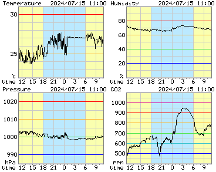

# Room_Environment_Manager

ESP32-based environment manager with Slack


## About

This project can do

* measure temperature, humidity, atmospheric pressure, and CO2 concentration
* show room environment on display
* send room environment on Slack every 1 hour
* send room environment graph (bitmap image) on Slack
* control an air conditioner via Slack
* control an optional humidifier via Slack, including humidity PID control and refill alerts

Graphs:



## Hardware

You need

* Main Module:
  * [ESP32 Dev Module (4MB)](https://akizukidenshi.com/catalog/g/g115673/)
  * [BME680](https://akizukidenshi.com/catalog/g/g114469/)
    * Temperature & Humidity & Atmospheric Pressure Sensor
    * I2C
  * [MH-Z19C](https://akizukidenshi.com/catalog/g/g116142/)
    * CO2 Sensor
    * Serial (RX=16, TX=17)
  * [SC2004CSLB](https://akizukidenshi.com/catalog/g/g100036/)
    * LCD Character Module (20x4)
* Air Conditioner Control Module:
  * [XIAO ESP32C3](https://akizukidenshi.com/catalog/g/g117454/)
  * Infrared LED
  * 2SC1815 Transistor
  * Some Resistors
* Additional Sensor Module 1:
  * [XIAO ESP32C3](https://akizukidenshi.com/catalog/g/g117454/)
  * [SHT40I](https://akizukidenshi.com/catalog/g/g130207/)
    * Temperature & Humidity Sensor
    * I2C
* Additional Sensor Module 2:
  * [XIAO ESP32C3](https://akizukidenshi.com/catalog/g/g117454/)
  * [BME280](https://akizukidenshi.com/catalog/g/g109421/)
    * Temperature & Humidity & Atmospheric Pressure Sensor
    * I2C
* Additional Sensor Module 3:
  * [XIAO ESP32C3](https://akizukidenshi.com/catalog/g/g117454/)
  * [SHT31](https://akizukidenshi.com/catalog/g/g112125/)
    * Temperature & Humidity Sensor
    * I2C

* Air Conditioner
  * I used Panasonic's one


## Hardware (Lite version)

* [XIAO ESP32C3](https://akizukidenshi.com/catalog/g/g117454/)
* [BME280](https://akizukidenshi.com/catalog/g/g109421/)
  * Temperature & Humidity & Atmospheric Pressure Sensor
  * I2C
* [SC2004CSLB](https://akizukidenshi.com/catalog/g/g100036/)
  * LCD Character Module (20x4)
* Infrared LED
* 2SC1815 Transistor
* Some Resistors
  * LED current limiting resistor (~100R)
  * LCD contrast adjustment resistor (~3.3k)
  * Transistor related circuits (~1k & 10k)


## Slack

You need

* Slack bot token
  * channels:history for public channel message events
  * groups:history for private channel message events
  * chat:write
  * files:write
* Slack app-level token for Socket Mode
  * create an app-level token with `connections:write`
  * define it in `main/room_environment_manager/token.h` as `SLACK_APP_TOKEN`
* Socket Mode
  * enable Socket Mode in Slack app settings
  * no public Request URL is required when Socket Mode is enabled
* Event Subscriptions
  * enable events in Slack app settings
  * subscribe Bot Events to `message.channels` for public channels
  * subscribe Bot Events to `message.groups` for private channels
  * reinstall the Slack app after changing scopes/events
  * invite the bot to the target channel

## Slack受信処理（main版）

Socket Modeのイベントは、WebSocketのペイロードを256バイトずつ読み、ArduinoJsonのフィルターで必要な項目だけ解析します。添付、プレビュー、更新前メッセージなどを受信サイズ分の `String` に保存することはありません。8KiBを超える通常のイベントにも対応し、分割フレームと途中のPing/Pongを処理します。

受信確認（ACK）は、Bot投稿・メッセージ更新・対象外チャンネルなどを除外する前に送信します。Bot識別情報があるメッセージは、`subtype` がなくてもコマンドとして実行しません。受け付けるコマンド本文は512バイトまでです。

処理量の上限は、1メッセージのペイロード合計256KiB、制御フレームを含め128フレーム、受信時間2.5秒（進捗がない場合は1秒）です。フィルターと解析結果のヒープ確保には合計16KiBの上限があります。保持対象の本文などが大きすぎて解析できないイベントは実行せず、残りを読み捨てます。その時点で `envelope_id` を取得できていればACKします。取得できなかった場合はACKできない旨をログに出します。通信断・不正なフレーム・受信上限超過の場合は接続を閉じて再接続します。

診断ログにはフレーム長、opcode、FIN、メッセージ全体の長さ、JSON解析のピーク確保量、イベント種別・subtype・再送回数を表示します。JSON解析用の確保量には、TLSなど別の処理が使うメモリは含みません。

Python 3、C++17対応の `g++` とArduinoJson 7を使い、以下で受信処理のテストを実行できます。

```sh
python tests/slack/run_tests.py --arduinojson-dir /path/to/ArduinoJson
```

ライブラリのパスは `ARDUINOJSON_DIR` 環境変数でも指定できます。テストは実際の受信・ACK・コマンド振り分けコードを使用し、18万バイトのイベント、分割フレーム、Bot投稿、次のフレームの保持、タイムアウト、不正フレーム、メモリ上限を確認します。実際のSlack接続や秘密情報を含む `token.h` は使用しません。

## 加湿器（main版・任意設置）

配線とESP-NOWのMACアドレス設定は [加湿器子機の説明](main/humidifier/README.md) を参照してください。既存のArduino ESP32 core 2.0.17で動作する構成です。

| Slackコマンド | 動作 |
| --- | --- |
| `hm on w` / `hm on weak` | 弱運転。自動制御を解除 |
| `hm on s` / `hm on strong` | 強運転。自動制御を解除 |
| `hm off` | 停止。自動制御も解除（未接続時も解除） |
| `hm a 50` / `hm auto 50` | 目標50%RHでPID制御。目標は0〜100、小数も可 |
| `hm alert on` / `hm alert off` | 給水アラートの有効・無効 |
| `hm mention on` / `hm mention off` | 給水アラートの `@channel` メンションの有効・無効 |

給水アラートは既定で有効、メンションは無効、自動加湿は無効です。自動加湿の有効・無効、目標湿度、アラート・メンション設定をEEPROMに保存します。手動のON状態は再起動後に再送しません。既存のエアコン設定と予約領域の位置は変更していません。`reserve` でも同じ `hm` コマンドを使用できます。

`monitor` と毎時の定期レポートの `Humidifier` 欄に、加湿器の **OFF / WEAK / STRONG**、水切れの **YES / NO**、自動制御の目標とPID出力、通知設定を表示します。接続状態は `Connection` 欄の `Humidifier controller` に表示します。未接続時の運転状態と水切れは **UNKNOWN** です。給水アラートは水切れを確認したときに一度送信し、水切れが解消して再発するまで繰り返しません。通知を再度有効にしたときは継続中の水切れも通知します。

### 応答の遅い加湿器のPID制御

既存の代表湿度を入力とし、30秒以上の間隔でPIDを更新します。計算結果0〜100%を停止・弱・強に変換します。湿度の変化率を使うD項には120秒の一次フィルターをかけ、湿度が上昇中なら出力を抑えます。I項には飽和時の蓄積防止と0〜100%の制限を入れています。

| 切替 | PID出力 |
| --- | --- |
| 停止 → 弱 | 25%以上 |
| 弱 → 停止 | 10%未満 |
| 停止・弱 → 強 | 70%以上 |
| 強 → 弱 | 55%未満（10%未満なら停止） |

自動切替は最短2分間隔です。`hm a` で目標を指定し直した場合はPIDの履歴をリセットして直ちに再評価し、手動ON/OFFもこの間隔に制限されません。目標0は停止出力です。有効な湿度が得られない場合や給水が必要な場合はPIDをリセットし、停止を要求します（通信失敗時の再試行にも2分間隔を適用）。

係数は [humidifier_pid.h](main/room_environment_manager/humidifier_pid.h) にまとめています。初期値は `Kp=12`, `Ki=0.015`, `Kd=300`（誤差は湿度の百分率ポイント、時間は秒）です。これは実機の応答を測定して調整するための開始値です。弱・強それぞれの加湿量、室内容積、換気、応答の遅れに合わせて調整してください。PC上のテストとESP32向けコンパイルで検証していますが、実機の応答・PID係数の最適値は未検証です。

### 未設置・通信断

親機に `HUMIDIFIER_MAC_ADDR` がなければ加湿器通信は完全に無効です。MACアドレスを設定していて子機が不在でも、既存の追加センサー問い合わせ（通常60秒間隔、1500ms待機）の通信枠を使うため、加湿器専用の待機時間は増えません。手動操作とPIDによる出力変更時は同じ通信処理を即時に実行します。未接続の定期警告は送信しません。

手動コマンドはLED状態を含む応答で成功を確認し、確認できなければその場で通知して終了します。後日の再接続時に手動コマンドを再送することはありません。自動加湿が有効なら、再接続して有効な湿度が得られると制御を再開します。子機は親機と5分間通信できない場合に運転停止を試みます。

### テスト

Python 3とC++17対応の `g++` があれば、`python tests/humidifier/run_tests.py` で実装コードを模擬ハードウェア上で検証できます。`CXX` 環境変数で別のC++コンパイラーを指定できます。秘密情報を含む実際の `token.h` は使用しません。
